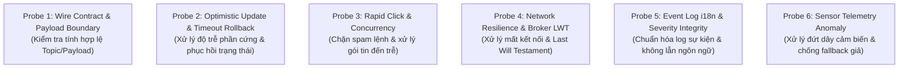

# 🎯 Cẩm Nang Kiểm Thử Đối Kháng (Adversarial Testing) — ESP32 Smart Home

> **Quy chuẩn:** Industrial-Grade IoT Testing Standards  
> **Áp dụng cho:** Nhánh `feat/ui-dashboard` (Mobile App) & Toàn bộ phân hệ kiểm thử IoT Monorepo  
> **Tôn chỉ tối thượng:** **Tiêu diệt kiểm thử đối phó, nghiêm cấm fake kết quả để qua mặt CI.** Mọi bài test phải có giá trị thực chứng, bảo vệ an toàn vật lý và tính toàn vẹn trạng thái của ngôi nhà thông minh.

---

## 1. Bối Cảnh & 4 Căn Bệnh Kiểm Thử "Tử Huyệt" Trong Dự Án IoT

Trong các dự án phần mềm điều khiển thiết bị phần cứng (ESP32, Cảm biến, Relay, Khóa cửa):
- CI báo **Test Xanh 100%**.
- Nhưng khi cắm nguồn thiết bị thật: Đèn không sáng, cửa không khóa được khi có sự cố, cảm biến đứt dây hiển thị 0°C làm chủ nhà tưởng an toàn, hoặc thao tác bấm nhanh khiến rơ-le nhảy loạn xạ.

Nguyên nhân cốt lõi là các căn bệnh kiểm thử đối phó:

```text
┌────────────────────────────────────────────────────────────────────────┐
│               4 CĂN BỆNH KIỂM THỬ TỬ HUYỆT CẦN TIÊU DIỆT               │
├────────────────────────────────┬───────────────────────────────────────┤
│ 1. Tautological Testing         │ Test tự tạo dữ liệu rồi tự assert     │
│    (Test tự xưng / Fake kết quả)│ chính dữ liệu đó; không qua logic thật│
├────────────────────────────────┼───────────────────────────────────────┤
│ 2. Happy-Path Monoculture      │ Chỉ test lúc WiFi căng đét, ESP32     │
│    (Chỉ test viễn cảnh màu hồng)│ luôn online, không bao giờ mất gói tin│
├────────────────────────────────┼───────────────────────────────────────┤
│ 3. Fat UI Component Blind Spot │ Nhét 800 dòng logic MQTT vào màn hình,│
│    (Vùng mù giao diện phình to)│ Unit test Node không thể render test  │
├────────────────────────────────┼───────────────────────────────────────┤
│ 4. Deceptive Fallback          │ Cảm biến lỗi/mất tin thì gán ?? 0,    │
│    (Che giấu sự cố bằng số giả)│ che giấu nguy hiểm hỏa hoạn/đứt dây   │
└────────────────────────────────┴───────────────────────────────────────┘
```

### Chi tiết 4 Căn Bệnh & Cách Trị Liệu:

| Căn bệnh | Biểu hiện trong code test | Hậu quả thực tế trong Smart Home | Giải pháp chuẩn công nghiệp |
|---|---|---|---|
| **1. Tautology (Test tự xưng)** | Khai báo `const mock = { topic: 'smarthome/cmd/door', payload: 'CLOSE' }` rồi assert `expect(mock.payload).toBe('CLOSE')` mà không qua hàm đóng gói của ứng dụng. | CI luôn xanh nhưng code thực tế gửi nhầm `"CLOSED"` vào `cmd/door`, ESP32 không hiểu lệnh và không đóng cửa. | **Quy tắc No-Tautology:** Chỉ assert trên output thực tế của hàm sản xuất (Pure Functions, Reducers, Payload Builders) hoặc state trong Store. Cấm assert trên mock tự định nghĩa. |
| **2. Happy-Path Monoculture** | Chỉ test kịch bản: Gửi lệnh $\to$ Nhận phản hồi ngay lập tức sau 10ms. Không có test mất kết nối, timeout, gửi lệnh liên tiếp. | Người dùng bấm nút mở cửa trong thang máy hoặc lúc WiFi yếu, app không phản hồi; hoặc người dùng bấm đúp nhanh làm kẹt động cơ servo. | Bắt buộc kiểm thử **Ma trận 6 Probes Đối Kháng IoT** (Mất kết nối, Timeout rollback, Debounce, Gói tin đến trễ). |
| **3. Fat UI Blind Spot** | Toàn bộ mã kết nối `mqtt.connect()`, parse JSON thẻ RFID, lọc log được viết thẳng trong `DashboardScreen.jsx` dài 800 dòng. | Vitest chạy trong Node.js không render native UI $\to$ Toàn bộ logic lõi của dự án không được test dòng nào. | **Kiến trúc 3 Tầng Headless:** Tách toàn bộ logic, state machine, parser ra các file `.js` thuần (`services/`, `hooks/`, `utils/`). File UI chỉ là lớp hiển thị mỏng (< 200 dòng). |
| **4. Deceptive Fallback** | Đọc cảm biến nhiệt độ bị null hoặc lỗi: `const temp = payload?.temperature ?? 0;` | Cảm biến DHT11 bị tuột dây hoặc cháy, app hiển thị nhiệt độ phòng là 0°C (lừa dối người dùng, tiềm ẩn nguy cơ cháy nổ). | **Tri-State & Fail-Closed:** Khi mất tín hiệu cảm biến hoặc payload hỏng, bắt buộc phát ra trạng thái `DISCONNECTED` / `UNKNOWN` kèm cảnh báo, tuyệt đối cấm dùng số liệu giả mạo `?? 0`. |

---

## 2. Kiến Trúc 3 Tầng Headless (Pragmatic Clean Architecture)

Để đảm bảo toàn bộ logic ứng dụng có thể kiểm thử tự động 100% trong môi trường Node.js (Vitest) với tốc độ milli-giây, toàn bộ phân hệ Mobile App tuân thủ cấu trúc 3 tầng:

```text
┌────────────────────────────────────────────────────────────────────────┐
│ 1. CONTRACTS & DOMAIN CORE (SSOT - Single Source of Truth)             │
│    - docs/mqtt-contract.json (Topic names, Payloads, QoS 0, LWT)       │
│    - Constants: TOPIC_CMD_LIGHT, TOPIC_CMD_DOOR, TOPIC_STATE_*, etc.   │
│    - JavaScript thuần: KHÔNG CHỨA UI, KHÔNG I/O, KHÔNG DEPENDENCY      │
└───────────────────────────────────┬────────────────────────────────────┘
                                    │
┌───────────────────────────────────▼────────────────────────────────────┐
│ 2. APPLICATION & HEADLESS LOGIC (100% TESTABLE TRONG VITEST / NODE)    │
│    - MQTT Client Manager & Connection State Machine                    │
│    - Device State Reducers (Light: ON/OFF, Door: OPEN/CLOSED)          │
│    - Optimistic Action Controller & Timeout Rollback (5s Timer)        │
│    - Event Log Parser & i18n Key Mapper (RFID, Motion, System Alert)   │
│    - 100% file .js thuần (services/, hooks/, utils/)                   │
│    - Chạy Unit Test siêu tốc < 500ms                                  │
└───────────────────────────────────┬────────────────────────────────────┘
                                    │
┌───────────────────────────────────▼────────────────────────────────────┐
│ 3. THIN PRESENTATION LAYER (DUMB REACT NATIVE UI)                      │
│    - Components & Screens (.jsx) < 200 dòng                            │
│    - Nhận ViewModel từ Headless Hooks và binding sự kiện thao tác      │
│    - CẤM: try/catch MQTT, parse JSON, hardcode chuỗi dịch thuật        │
└────────────────────────────────────────────────────────────────────────┘
```

---

## 3. Ma Trận 6 Probes Đối Kháng Dành Riêng Cho IoT Smart Home

Mọi tính năng liên quan đến thiết bị và dữ liệu trong dự án bắt buộc phải được bảo vệ bởi **Ma trận 6 Probes Đối Kháng**:



### 🔹 Probe 1: Wire Contract & Malformed Payload Boundary Probe
* **Tư duy:** Không bao giờ tin tưởng tuyệt đối vào dữ liệu trên đường truyền. Gói tin có thể bị can nhiễu, sai chuẩn hoặc bị gõ nhầm chữ hoa/thường.
* **Kịch bản kiểm thử:**
  1. *Lệnh đóng cửa:* Hàm phát lệnh phải xuất đúng topic `smarthome/cmd/door` và payload `"CLOSE"`. **Assert:** Cấm xuất `"CLOSED"`, cấm xuất `"close"`, cấm bao bọc ngoặc kép dư thừa (`"\"CLOSE\""`).
  2. *Sự kiện thẻ RFID:* Nạp payload thiếu trường `uid` hoặc `result` khác `GRANTED`/`DENIED` (ví dụ: `{"uid":"123"}` hoặc `{"result":"OK"}`). **Assert:** Parser bỏ qua an toàn, phát log cảnh báo, không làm crash ứng dụng.
  3. *Độ dài payload:* Gói tin RFID vượt quá 128 bytes **Assert:** Bị từ chối kiểm thực theo quy định mục 3 của Hợp đồng MQTT.

### 🔹 Probe 2: Optimistic UI & Timeout Rollback Probe
* **Tư duy:** Mạng vô tuyến và rơ-le phần cứng luôn có độ trễ vật lý (vài trăm mili-giây đến vài giây).
* **Kịch bản kiểm thử:**
  1. Người dùng bấm công tắc mở cửa trên Mobile App.
  2. UI chuyển sang trạng thái chuyển tiếp (Pending / Optimistic `OPEN`).
  3. **Ca thành công:** ESP32 gửi gói tin `smarthome/state/door` = `"OPEN"` trong vòng 5s $\rightarrow$ UI xác nhận trạng thái chính thức `OPEN`.
  4. **Ca lỗi (ESP32 mất nguồn hoặc actuator kẹt):** Sau 5s không nhận được tin xác nhận từ `smarthome/state/door` $\rightarrow$ UI **bắt buộc rollback** về trạng thái trước đó (`CLOSED`) và kích hoạt thông báo cảnh báo lỗi trên giao diện.

### 🔹 Probe 3: Concurrency, Rapid Click & Stale Packet Probe
* **Tư duy:** Người dùng có xu hướng ấn liên tục nhiều lần vào nút bấm khi thấy đèn chưa sáng ngay; gói tin mạng có thể bị trễ và đến không đúng thứ tự.
* **Kịch bản kiểm thử:**
  1. Giả lập người dùng bấm nút bật/tắt đèn 5 lần liên tiếp trong vòng 300ms.
  2. **Assert:** Cơ chế Throttle/Debounce chỉ gửi lệnh cuối cùng hoặc xử lý tuần tự có hàng đợi; không gây bão gói tin (packet storm) làm tràn bộ đệm ESP32.
  3. Giả lập nhận gói tin trạng thái cũ (timestamp cũ) từ broker sau khi người dùng đã phát lệnh mới $\rightarrow$ Không được ghi đè trạng thái mới bằng dữ liệu cũ (Stale write rejection).

### 🔹 Probe 4: Network Resilience & Broker LWT (Last Will) Probe
* **Tư duy:** Mất kết nối WiFi, tắt nguồn đột ngột là điều xảy ra thường xuyên trong nhà thông minh.
* **Kịch bản kiểm thử:**
  1. Giả lập broker phát ra gói tin Last Will: `smarthome/state/online` với payload `"OFFLINE"`.
  2. **Assert:** Mobile App chuyển ngay lập tức toàn bộ trạng thái thiết bị sang chế độ `OFFLINE / UNREACHABLE`, vô hiệu hóa các nút bấm điều khiển để người dùng không thao tác mù, hiển thị banner thông báo "Mất kết nối với bộ điều khiển ESP32".

### 🔹 Probe 5: Event Log Localization & Severity Integrity Probe
* **Tư duy:** Nhật ký sự kiện (Event Tracking) là nơi lưu trữ bằng chứng an ninh. Không được lưu chuỗi tĩnh mà phải lưu cấu trúc dữ liệu chìa khóa (key-based).
* **Kịch bản kiểm thử:**
  1. Ghi nhận 3 sự kiện: Thẻ quẹt hợp lệ (`GRANTED`), Thẻ bị từ chối (`DENIED`), Board ngắt kết nối (`OFFLINE`).
  2. **Assert phân loại Severity:** `GRANTED` $\rightarrow$ `INFO`; `DENIED` $\rightarrow$ `WARN`; `OFFLINE` $\rightarrow$ `CRITICAL`.
  3. Chuyển đổi ngôn ngữ hệ thống từ Tiếng Anh sang Tiếng Việt:
     - **Assert:** Toàn bộ lịch sử log hiển thị bằng Tiếng Việt chuẩn mực.
     - Chuyển ngược lại Tiếng Anh: Hiển thị Tiếng Anh hoàn chỉnh.
     - **Tuyệt đối không lưu chuỗi tĩnh** dẫn đến tình trạng trong cùng một danh sách log vừa có dòng tiếng Anh vừa có dòng tiếng Việt lộn xộn.

### 🔹 Probe 6: Sensor Telemetry Anomaly & Fail-Closed Probe
* **Tư duy:** Cảm biến DHT11 hoặc quang trở có thể bị lỏng chân, nhiễu ADC, hoặc chập mạch.
* **Kịch bản kiểm thử:**
  1. Giả lập payload cảm biến trả về giá trị bất thường: `temperature = -999`, `temperature = null`, `temperature = NaN`, hoặc `humidity = 150%`.
  2. **Assert:** Tầng parser đánh dấu trạng thái cảm biến là `INVALID / SENSOR_ERROR`.
  3. **Assert:** Giao diện hiển thị dấu gạch ngang `-- °C` hoặc icon cảnh báo, **tuyệt đối không dùng `?? 0`** để hiển thị 0°C.

---

## 4. Phân Biệt Test Giả Tạo (Fake Test) vs Test Chuẩn Công Nghiệp (Industrial Test)

Dưới đây là các ví dụ đối chiếu trực quan để mọi thành viên nhận diện và loại trừ test đối phó:

### ❌ Ví Dụ 1: Kiểm tra lệnh đóng cửa

```javascript
// ❌ TEST GIẢ TẠO (TAUTOLOGY) - VÔ GIÁ TRỊ, CHỈ ĐỂ QUA MẶT CI
test('door close command', () => {
  const expectedPayload = 'CLOSE';
  // Tự gán rồi tự assert chính biến mình vừa tạo!
  expect(expectedPayload).toBe('CLOSE'); 
});

// ✅ TEST CHUẨN CÔNG NGHIỆP (CONTRACT-BOUND)
import { buildDoorCommandPayload, TOPICS } from '../contracts/mqtt';

test('buildDoorCommandPayload should return CLOSE for lock action and target correct topic', () => {
  const action = { type: 'DOOR_LOCK' };
  const message = buildDoorCommandPayload(action);
  
  // Assert trên kết quả hàm nghiệp vụ thật
  expect(message.topic).toBe(TOPICS.CMD_DOOR);
  expect(message.payload).toBe('CLOSE'); // Tuyệt đối không phải CLOSED
  expect(typeof message.payload).toBe('string');
});
```

### ❌ Ví Dụ 2: Xử lý cảm biến mất tín hiệu

```javascript
// ❌ TEST GIẢ TẠO (NUỐT LỖI BẰNG SỐ LIỆU GIẢ ?? 0)
test('sensor parser fallback', () => {
  const malformedData = {};
  // Nuốt lỗi bằng số 0, lừa dối người dùng
  const temp = malformedData.temp ?? 0;
  expect(temp).toBe(0); // Test xanh nhưng nguy hiểm chết người!
});

// ✅ TEST CHUẨN CÔNG NGHIỆP (FAIL-CLOSED)
import { parseTelemetryPayload } from '../services/telemetry';

test('parseTelemetryPayload should emit DISCONNECTED state when payload is empty or invalid', () => {
  const malformedPayload = Buffer.from('{}');
  const result = parseTelemetryPayload(malformedPayload);
  
  expect(result.status).toBe('DISCONNECTED');
  expect(result.temperature).toBeNull(); // Không được là 0
  expect(result.hasError).toBe(true);
});
```

### ❌ Ví Dụ 3: Đồng bộ ngôn ngữ Event Log

```javascript
// ❌ TEST GIẢ TẠO (LƯU CHUỖI TĨNH GÂY LỘN XỘN NGÔN NGỮ)
test('format access event', () => {
  // Lưu cứng chuỗi tiếng Anh vào database/store
  const log = "Card A1B2C3D4 Access Granted";
  expect(log).toContain("Granted");
});

// ✅ TEST CHUẨN CÔNG NGHIỆP (KEY-BASED LOCALIZATION)
import { createAccessEventLog, renderEventMessage } from '../services/eventLog';

test('event log should use translation keys and render correctly in both EN and VI', () => {
  const rawEvent = { uid: 'A1B2C3D4', result: 'GRANTED', timestamp: 1713333333 };
  const logItem = createAccessEventLog(rawEvent);
  
  // Cấu trúc lưu trữ độc lập ngôn ngữ
  expect(logItem.i18nKey).toBe('events.access.granted');
  expect(logItem.params).toEqual({ uid: 'A1B2C3D4' });
  expect(logItem.severity).toBe('INFO');
  
  // Render mượt mà sang Tiếng Anh
  const enText = renderEventMessage(logItem, 'en');
  expect(enText).toBe('Card A1B2C3D4 access granted');
  
  // Render mượt mà sang Tiếng Việt mà không cần sửa dữ liệu gốc
  const viText = renderEventMessage(logItem, 'vi');
  expect(viText).toBe('Thẻ A1B2C3D4 đã mở cửa thành công');
});
```

---

## 5. Quy Chuẩn Đánh Giá Bài Test Trước Khi Duyệt PR

Một bài kiểm thử chỉ được chấp nhận vào nhánh chính khi thỏa mãn **Bộ Tiêu Chí 5 Điểm (The 5-Point Test Bar)**:

1. **Tính độc lập:** Không phụ thuộc thứ tự chạy test, dọn dẹp state sạch sẽ sau mỗi ca test (`afterEach`).
2. **Tính tất định:** Chạy 100 lần cho ra 100 kết quả đồng nhất, không phụ thuộc vào thời gian thực hoặc tốc độ mạng ngẫu nhiên.
3. **Mục tiêu rõ ràng:** Mỗi ca test chỉ kiểm tra một hành vi cụ thể (Single Behavioral Responsibility).
4. **Không phụ thuộc UI Native:** Logic nghiệp vụ chạy hoàn toàn trong môi trường Node.js mà không cần khởi động giả lập thiết bị di động.
5. **Tuân thủ Hợp đồng:** Mọi hằng số topic và payload bắt buộc tham chiếu từ `docs/mqtt-contract.json`.

